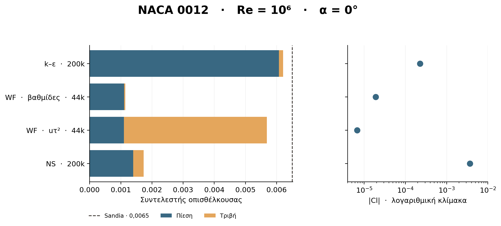
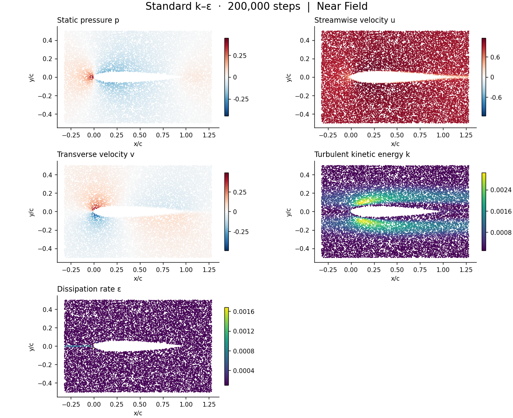
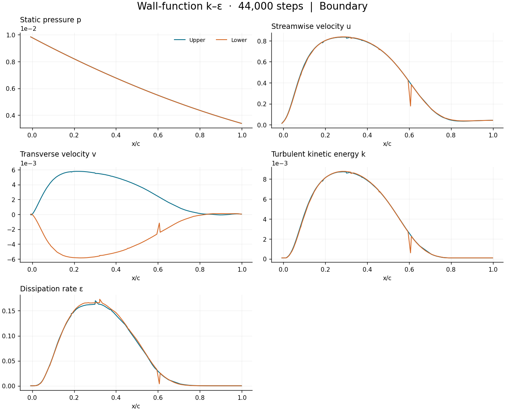

# Airfoil aerodynamics with physics-informed neural networks

Can a network recover the forces on a symmetric airfoil from the governing equations and boundary conditions? This thesis studies steady, two-dimensional flow over a NACA 0012 at zero incidence. The three selected models use the same chord Reynolds number, **Re = 1,000,000**. This makes differences in lift, drag and wall treatment visible without changing the operating point.

The author reports more than 200 exploratory trials across the wider thesis project. The public inventory documents the three selected Ver1 models.

## Three models at the same Reynolds number

| Model | Equations and wall treatment | Field step |
|---|---|---:|
| [Navier–Stokes](models/Ver1/navier-stokes/) | Steady incompressible continuity and momentum. The network predicts streamwise velocity, transverse velocity and pressure. | 200,000 |
| [Standard k–ε](models/Ver1/k-epsilon/) | RANS with transport equations for turbulent kinetic energy and dissipation. The airfoil constraint imposes zero velocity and zero turbulent kinetic energy. | 200,000 |
| [Wall-function k–ε](models/Ver1/k-epsilon_wf_1/) | RANS with a Launder–Spalding equilibrium wall treatment. Off-wall distance and friction velocity enter the near-wall closure. | 44,000 |

The geometry and sampling build on NVIDIA's PhysicsNeMo Sym NACA example. A signed-distance representation distinguishes the airfoil from the fluid. The training objective combines residuals of the differential equations in the fluid with inlet, outlet and airfoil constraints. The saved inference points provide a common geometry for inspecting the pressure and velocity distributions. [NVIDIA airfoil example](https://github.com/NVIDIA/physicsnemo-sym/tree/main/examples/airfoil_pinn/naca)

## Lift, drag and the source of wall friction

A symmetric airfoil at zero incidence should give lift close to zero. The table reports absolute lift because the two post-processing pipelines use different lift signs. The drag reference is **0.0065**, the zero-incidence Eppler polar in Table 2 of Sheldahl and Klimas. It is a numerical reference for total drag. [Sandia report SAND80-2114](https://www.osti.gov/servlets/purl/6548367)

| Model and extraction | Absolute Cl | Cd | Difference from reference | Friction share |
|---|---:|---:|---:|---:|
| Navier–Stokes, velocity gradients | 0.003675 | 0.001734 | −73.32% | 19.26% |
| Standard k–ε, velocity gradients | 0.000227 | 0.006210 | −4.47% | 2.17% |
| Wall-function k–ε, velocity gradients | 0.0000191 | 0.001141 | −82.44% | 3.01% |
| Wall-function k–ε, surface friction velocity | 0.00000677 | 0.005684 | −12.55% | 80.63% |

Standard k–ε gives the closest total drag, with **97.83% attributed to pressure**. For the wall-function model, changing the shear extraction on the *same saved field* moves the friction share from **3.01% to 80.63%**. The force split therefore depends on the post-processing method. Independent pressure and skin-friction data at matching flow and transition conditions would be needed to validate either split. [Numerical results](results/v1.csv) · [Force definitions](docs/method.md)

## What the saved fields show

The standard k–ε near field at step 200,000 shows the exported static pressure, both velocity components, turbulent kinetic energy and dissipation. Each panel has its own color scale.

The wall-function model at step 44,000 provides upper- and lower-surface profiles of the same five quantities against chord position.

[Field gallery and ParaView files](fields/README.md) · [Training loss histories](figures/loss.png)

## Wall-function development

The Ver2 attempts test whether moving the evaluation points and controlling their local wall coordinate improves aerodynamic predictions. At a point a distance d into the fluid, the equilibrium closure uses uτ = Cμ^(1/4) √k and y⁺ = uτd/ν. D_yplus projects sampled points onto the curved surface, constructs an outward offset and applies the shear condition along a local tangent. Soft limits on y⁺ target the modeled log layer. The initialization, mixed and physics stages share a checkpoint. [D_yplus implementation and sources](models/Ver2/D_yplus/SOURCES_AND_METHOD.md) · [Stage commands](models/Ver2/D_yplus/RUN_NOTES.md)

At step 400,000, A had a loss of 2.68×10⁻⁵ and mean y⁺ of 1.02. B also had mean y⁺ of 1.02 and overpredicted drag by 44–45%. In D_yplus all 512 off-wall points reached y⁺ between 45.58 and 57.65, yet all had negative streamwise velocity. Its surface-friction estimate gave Cd = 0.06013. Wall-layer placement, training loss and integrated forces thus give different information about a run. [Ver2 measurements and limitations](docs/Ver2.md)

## Using the repository

The [selected version inventory](inventory/selected_versions.csv) connects the original run names to their model and field folders. The [Ver1 scripts](models/Ver1/) use the `physicsnemo.sym` API, with Hydra configurations beside each entry point. The [field plotting script](tools/plot_fields.py) reads saved VTP data using ParaView's Python environment with NumPy and Matplotlib. The training scripts were inspected statically during repository preparation. The exported field and force data can be examined independently of training.
